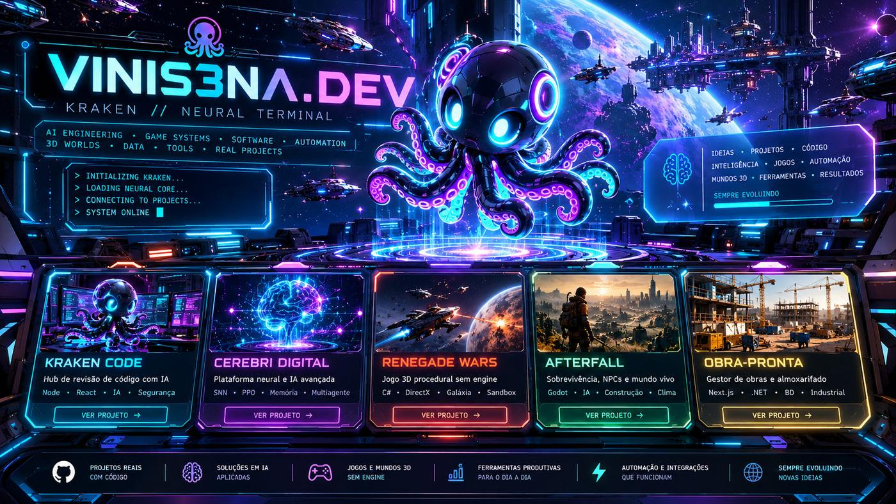

# VINIS3NA.DEV
**KRAKEN // COMMAND CENTER V3**

**IA & SISTEMAS NEURAIS** · **ENGENHARIA DE SOFTWARE** · **JOGOS & SIMULAÇÃO 3D**

[**◈ ABRIR PORTFÓLIO**](https://vinis3na-dev.github.io/vinis3na-dev/) &nbsp;·&nbsp; [**PROJETOS**](#-projetos-em-destaque) &nbsp;·&nbsp; [**TECNOLOGIAS**](#-matriz-tecnológica) &nbsp;·&nbsp; [**REPOSITÓRIOS**](https://github.com/vinis3na-dev?tab=repositories)

*Exploração espacial, sistemas inteligentes e experiências digitais.*

---

## ◈ KRAKEN // Visão Geral

<table>
<tr>
<td width="52%" valign="top">

### Engenharia & Pesquisa

Desenvolvimento de **IA aplicada, aplicativos, ferramentas desktop, jogos e experiências 3D**, com atenção à arquitetura, testes e evolução incremental.

- **Inteligência artificial:** agentes, memória, sistemas neurais e modelos locais.
- **Software:** desktop, aplicações web, APIs e automação.
- **Game systems:** mundos persistentes, sistemas procedurais e NPCs.
- **Engenharia:** integrações, validação e manutenção de projetos reais.

</td>
<td width="48%" valign="top">

### Matriz de Atuação

| Área | Stack |
|:--|:--|
| **IA / Neural** | Python · Ollama · SNN |
| **Desktop / Web** | C# · .NET · React · TypeScript |
| **Jogos / 3D** | Godot · GDScript · OpenTK |
| **Sistemas** | Node.js · APIs · Git |

[**EXPLORAR CENTRAL DE COMANDO ↗**](https://vinis3na-dev.github.io/vinis3na-dev/)

</td>
</tr>
</table>

## 🚀 Projetos em Destaque

*Uma galeria de projetos e pesquisa. As imagens são artes conceituais, não capturas dos aplicativos.*

<table>
<tr>
<td width="50%" valign="top">

### 🐙 KRAKEN Code

Ambiente desktop de programação assistida por IA, com agentes e ferramentas de desenvolvimento.

**Electron · React · TypeScript**

[**REPOSITÓRIO (ACESSO RESTRITO) ↗**](https://github.com/vinis3na-dev/kraken-code)

</td>
<td width="50%" valign="top">

### 🧠 Cerebri Digital

Laboratório experimental de arquiteturas neurais, memória, planejamento, aprendizado e agentes.

**Python · SNN · Sistemas neurais**

[**EXPLORAR LABORATÓRIO ↗**](https://vinis3na-dev.github.io/vinis3na-dev/#laboratorio)

</td>
</tr>
<tr>
<td width="50%" valign="top">

### 🚀 Renegade Wars

Jogo espacial procedural em C#, com exploração, renderização e sistemas de gameplay.

**C# · .NET · 3D**

[**VER NO PORTFÓLIO ↗**](https://vinis3na-dev.github.io/vinis3na-dev/#projetos)

</td>
<td width="50%" valign="top">

### 🌆 Afterfall

Sobrevivência em Godot com mundo persistente, NPCs autônomos, recursos e exploração.

**Godot · GDScript · Survival**

[**REPOSITÓRIO (ACESSO RESTRITO) ↗**](https://github.com/vinis3na-dev/AFTERFALL)

</td>
</tr>
<tr>
<td width="50%" valign="top">

### 🏗️ Obra-Pronta

Gestão de obras, estoque, requisições e processos operacionais com foco em engenharia.

**Aplicações web · Backend · Gestão**

[**VER NO PORTFÓLIO ↗**](https://vinis3na-dev.github.io/vinis3na-dev/#projetos)

</td>
<td width="50%" valign="top">

### 🌌 KRAKEN Command Center V3

**O portfólio interativo em ambiente espacial.** Câmeras 3D, salas holográficas, transições e exploração dos projetos.

[**ABRIR EXPERIÊNCIA V3 ↗**](https://vinis3na-dev.github.io/vinis3na-dev/)

</td>
</tr>
</table>

## 🛠️ Matriz Tecnológica

<table>
<tr>
<td width="33%" valign="top">

### 🧠 AI & Neural

**Python · Ollama · Agentes**

Modelos locais, memória, automação, redes neurais e aprendizado experimental.

</td>
<td width="33%" valign="top">

### ⚙️ Software

**C# · .NET · TypeScript**

React, Node.js, Electron, APIs e aplicativos desktop e web.

</td>
<td width="34%" valign="top">

### 🎮 World Systems

**Godot · GDScript · OpenTK**

Renderização, sobrevivência, sistemas procedurais, física e simulação 3D.

</td>
</tr>
</table>

## 📡 Atividade e Código

<table>
<tr>
<td width="50%" valign="top">

### Repositórios e contribuições

Projetos públicos, código disponível e histórico real de contribuições. **Sem contadores simulados.**

[**VER REPOSITÓRIOS ↗**](https://github.com/vinis3na-dev?tab=repositories)

</td>
<td width="50%" valign="top">

### Experiência interativa

O README oferece uma apresentação estática. As câmeras, salas holográficas e animações WebGL funcionam no site V3.

[**ABRIR PORTFÓLIO ↗**](https://vinis3na-dev.github.io/vinis3na-dev/)

</td>
</tr>
</table>

## 📂 Catálogo Completo

<b>Expandir catálogo de repositórios e experimentos</b>

Os links abaixo foram preservados do perfil anterior. Alguns repositórios são privados e podem não estar visíveis para todos os visitantes.

### 🎮 Jogos e Simuladores 3D

| Repositório | Descrição | Tecnologia |
|---|---|---|
| [N3xuscom](https://github.com/vinis3na-dev/N3xuscom) | Nexus Office — escritório 3D com servidor Python, painel web, voz e tela compartilhada | Godot 4.7 + Python |
| [AsteriaFrontier](https://github.com/vinis3na-dev/AsteriaFrontier) | Exploração espacial procedural — pousar, minerar, craftar, salvar | Godot 4.7 + GDScript |
| [ocean-survival-3d](https://github.com/vinis3na-dev/ocean-survival-3d) | Sobrevivência no mar — crafting, clima dinâmico, tubarões, ilhas | Godot 4.7 |
| [AFTERFALL](https://github.com/vinis3na-dev/AFTERFALL) | Jogo de sobrevivência — Alpha RC1 com código fonte recuperado | Godot 4.7 |
| [cw-cyberpunk-neon-alley](https://github.com/vinis3na-dev/cw-cyberpunk-neon-alley) | Mapa GTA V/FiveM vanilla — tema cyberpunk, CodeWalker | Lua + CodeWalker |
| [rocky](https://github.com/vinis3na-dev/rocky) | FPS em primeira pessoa — C++20 + Vulkan, câmera FPS, Mark 23 | C++ + Vulkan |
| [star](https://github.com/vinis3na-dev/star) | Jogo 3D de sobrevivência — ECS, Jolt Physics, OpenGL 4.6 PBR | C++20 |
| [skyhawk](https://github.com/vinis3na-dev/skyhawk) | Simulador de voo — Three.js + TypeScript + Vite | Three.js + TS |
| [piratas](https://github.com/vinis3na-dev/piratas) | Jogo 3D de piratas — mundo aberto, dia/noite, comércio | Three.js + JS |

### 🤖 IA e Automação

| Repositório | Descrição | Tecnologia |
|---|---|---|
| [control-center](https://github.com/vinis3na-dev/control-center) | Painel local para modelos Ollama/Colibri/OpenAI integrado ao OpenCode | Python |
| [sync-hub](https://github.com/vinis3na-dev/sync-hub) | Control room de agentes IA — fila, orçamento, escritório 3D | React + Express + Three.js |
| [kraken](https://github.com/vinis3na-dev/kraken) | Laboratório genômico — 21 espécies, mecanismos candidatos, benchmark | Python |
| [automathon](https://github.com/vinis3na-dev/automathon) | Automação de publicação YouTube — FastAPI + React + CustomTkinter | Python + React |
| [youtube-automation](https://github.com/vinis3na-dev/youtube-automation) | Programa desktop único para automação de publicação YouTube | Python |
| [tribuna-capixaba-app](https://github.com/vinis3na-dev/tribuna-capixaba-app) | Painel de curadoria de notícias RSS com IA — WordPress + redes sociais | Python |

### 🌐 Web

| Repositório | Descrição | Tecnologia |
|---|---|---|
| [last-delivery](https://github.com/vinis3na-dev/last-delivery) | Jogo pós-apocalíptico — sobrevivência/entrega, HTML5 Canvas puro | HTML5 + JS |

---

### KRAKEN // EXPLORE · BUILD · EVOLVE

**[COMMAND CENTER V3](https://vinis3na-dev.github.io/vinis3na-dev/)** · **[GITHUB](https://github.com/vinis3na-dev)** · **[REPOSITÓRIOS](https://github.com/vinis3na-dev?tab=repositories)**

Visual cinematográfico com conteúdo técnico real. Artes conceituais identificadas; repositórios privados exigem acesso. A experiência 3D acontece no portfólio, não no README.

