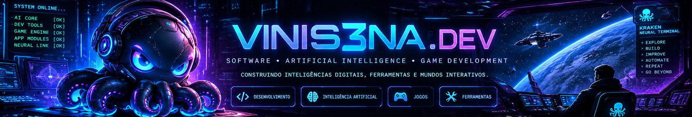
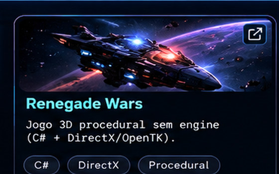
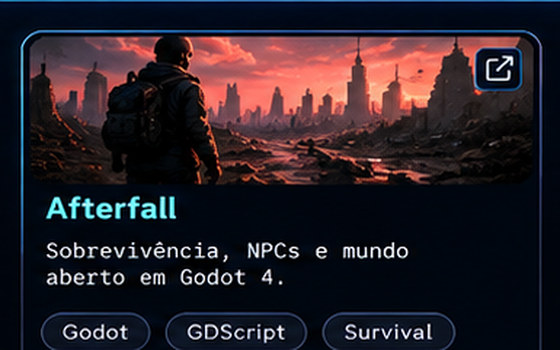
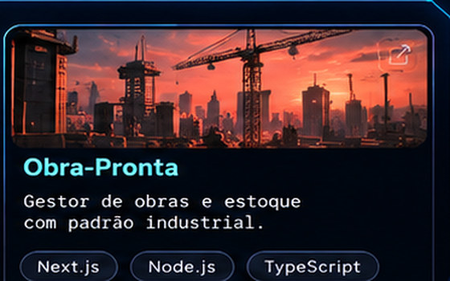

### KRAKEN // COMMAND CENTER V3

**Engenharia de IA** · **Mundos 3D** · **Software** · **Sistemas neurais**

[**PROJETOS**](#-projetos-em-destaque) · [**LABORATÓRIO NEURAL**](#-laboratório-neural) · [**REPOSITÓRIOS**](https://github.com/vinis3na-dev?tab=repositories)

*Exploração espacial, sistemas inteligentes e experiências digitais.*

**[Abrir portfólio cinematográfico V3](https://vinis3na-dev.github.io/vinis3na-dev/)** · [Explorar repositórios](https://github.com/vinis3na-dev?tab=repositories)

---

## 🚀 Projetos em Destaque

Uma seleção visual dos projetos. As artes são conceituais; clique para ler os detalhes.

<table>
<tr>
<td align="center" width="50%"></td>
<td align="center" width="50%"></td>
</tr>
<tr>
<td align="center"></td>
<td align="center"></td>
</tr>
<tr>
<td align="center" colspan="2"></td>
</tr>
</table>

### Kraken Code
Assistente e ambiente desktop para desenvolvimento com agentes e ferramentas de IA. **Projeto privado:** [abrir repositório, caso tenha acesso](https://github.com/vinis3na-dev/kraken-code).

### Cerebri Digital
Laboratório experimental de sistemas neurais, memória, planejamento e agentes. Representação visual conceitual.

### Renegade Wars
Jogo espacial 3D procedural desenvolvido em C# com foco em exploração e sistemas de jogo. Representação visual conceitual.

### Afterfall
Experimentos em sobrevivência 3D, NPCs autônomos e simulação em Godot. **Projeto privado:** [abrir repositório, caso tenha acesso](https://github.com/vinis3na-dev/AFTERFALL).

### Obra-Pronta
Aplicação de gestão de obras, estoque e processos operacionais. Representação visual conceitual.

---

## 🧠 Laboratório Neural

**Cerebri Digital:** pesquisa experimental em arquiteturas neurais, agentes, memória e aprendizado. A imagem é uma representação artística, não telemetria ou captura de software.

O laboratório interativo da V3 oferece transições holográficas e movimento suave no navegador; o README do GitHub utiliza imagens estáticas para preservar a qualidade visual.

---

## 🛠️ Tecnologias e Ferramentas

| Inteligência artificial | Jogos e gráficos | Aplicações e infraestrutura |
|:--:|:--:|:--:|
| Python · Agentes · Ollama | Godot · GDScript · Three.js | TypeScript · JavaScript · React |
| Redes neurais · Memória | C# · C++ · OpenGL · Vulkan | .NET · Node.js · Vite · Git |

---

## 📂 Outros Projetos

<b>Expandir catálogo de repositórios e experimentos</b>

Os links abaixo foram preservados do perfil anterior. Alguns repositórios são privados e podem não estar visíveis para todos os visitantes.

### 🎮 Jogos e Simuladores 3D

| Repositório | Descrição | Tecnologia |
|---|---|---|
| [N3xuscom](https://github.com/vinis3na-dev/N3xuscom) | Nexus Office — escritório 3D com servidor Python, painel web, voz e tela compartilhada | Godot 4.7 + Python |
| [AsteriaFrontier](https://github.com/vinis3na-dev/AsteriaFrontier) | Exploração espacial procedural — pousar, minerar, craftar, salvar | Godot 4.7 + GDScript |
| [ocean-survival-3d](https://github.com/vinis3na-dev/ocean-survival-3d) | Sobrevivência no mar — crafting, clima dinâmico, tubarões, ilhas | Godot 4.7 |
| [AFTERFALL](https://github.com/vinis3na-dev/AFTERFALL) | Jogo de sobrevivência — Alpha RC1 com código fonte recuperado | Godot 4.7 |
| [cw-cyberpunk-neon-alley](https://github.com/vinis3na-dev/cw-cyberpunk-neon-alley) | Mapa GTA V/FiveM vanilla — tema cyberpunk, CodeWalker | Lua + CodeWalker |
| [rocky](https://github.com/vinis3na-dev/rocky) | FPS em primeira pessoa — C++20 + Vulkan, câmera FPS, Mark 23 | C++ + Vulkan |
| [star](https://github.com/vinis3na-dev/star) | Jogo 3D de sobrevivência — ECS, Jolt Physics, OpenGL 4.6 PBR | C++20 |
| [skyhawk](https://github.com/vinis3na-dev/skyhawk) | Simulador de voo — Three.js + TypeScript + Vite | Three.js + TS |
| [piratas](https://github.com/vinis3na-dev/piratas) | Jogo 3D de piratas — mundo aberto, dia/noite, comércio | Three.js + JS |

### 🤖 IA e Automação

| Repositório | Descrição | Tecnologia |
|---|---|---|
| [control-center](https://github.com/vinis3na-dev/control-center) | Painel local para modelos Ollama/Colibri/OpenAI integrado ao OpenCode | Python |
| [sync-hub](https://github.com/vinis3na-dev/sync-hub) | Control room de agentes IA — fila, orçamento, escritório 3D | React + Express + Three.js |
| [kraken](https://github.com/vinis3na-dev/kraken) | Laboratório genômico — 21 espécies, mecanismos candidatos, benchmark | Python |
| [automathon](https://github.com/vinis3na-dev/automathon) | Automação de publicação YouTube — FastAPI + React + CustomTkinter | Python + React |
| [youtube-automation](https://github.com/vinis3na-dev/youtube-automation) | Programa desktop único para automação de publicação YouTube | Python |
| [tribuna-capixaba-app](https://github.com/vinis3na-dev/tribuna-capixaba-app) | Painel de curadoria de notícias RSS com IA — WordPress + redes sociais | Python |

### 🌐 Web

| Repositório | Descrição | Tecnologia |
|---|---|---|
| [last-delivery](https://github.com/vinis3na-dev/last-delivery) | Jogo pós-apocalíptico — sobrevivência/entrega, HTML5 Canvas puro | HTML5 + JS |

---

## 📡 Atividade e Contribuições

Explore as contribuições e os repositórios pela [página pública do GitHub](https://github.com/vinis3na-dev). Não exibo contadores fixos ou status fictícios.

---

**KRAKEN // V3 • EXPLORE • BUILD • EVOLVE**

[Repositórios](https://github.com/vinis3na-dev?tab=repositories) · [Perfil](https://github.com/vinis3na-dev)

Identidade visual cinematográfica • Artes conceituais, não capturas de aplicativos. A experiência 3D da V3 requer site próprio: o GitHub README não executa WebGL ou JavaScript.

