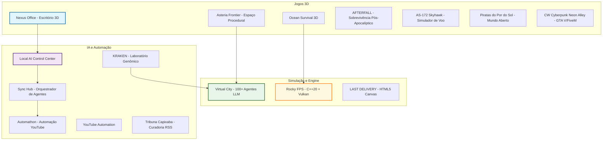
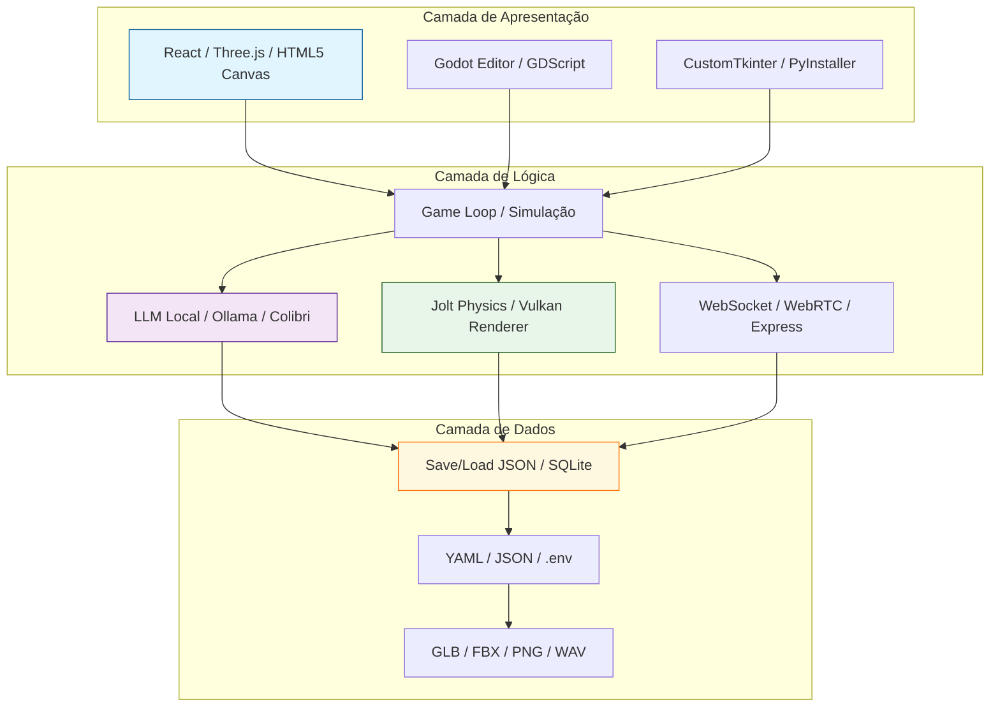

# 👨‍💻 vinis3na-dev

**Desenvolvedor de Software Sênior | Especialista em Jogos, Simuladores e Ferramentas de IA**

Criador de experiências imersivas com Godot, Three.js, C++/Vulkan, Python e React. Foco em arquitetura limpa, sistemas de simulação complexos e integração de IA local.

---

## 📊 Visão Geral do Perfil

---

## 🛠️ Stack Tecnológica

### Engines e Gráficos

### Linguagens e Backend

### IA e Dados

---

## 🚀 Projetos em Destaque

### 🎮 Jogos e Simuladores 3D

| Projeto | Descrição | Tech Stack | Status |
|---|---|---|---|
| **[N3xuscom](https://github.com/vinis3na-dev/N3xuscom)** | Escritório 3D com servidor Python, painel web, voz e tela compartilhada | Godot 4.7 + Python + WebRTC | ✅ Ativo |
| **[AsteriaFrontier](https://github.com/vinis3na-dev/AsteriaFrontier)** | Exploração espacial procedural com planetas esfericos, biomas e nave-base | Godot 4.7 + GDScript | ✅ Ativo |
| **[Ocean Survival 3D](https://github.com/vinis3na-dev/ocean-survival-3d)** | Sobrevivência no mar com crafting, clima dinâmico, tubarões e quests | Godot 4.7 | ✅ Ativo |
| **[AFTERFALL](https://github.com/vinis3na-dev/AFTERFALL)** | Jogo de sobrevivência pós-apocalíptico Alpha RC1 com código fonte | Godot 4.7.2 | ✅ Ativo |
| **[AS-172 Skyhawk](https://github.com/vinis3na-dev/skyhawk)** | Simulador de voo com piloto automático, ILS, falhas e carreira | Three.js + TypeScript + Vite | ✅ Ativo |
| **[Piratas do Por do Sol](https://github.com/vinis3na-dev/piratas)** | Jogo 3D de piratas com mundo aberto, dia/noite, fantasmas e comércio | Three.js + JavaScript | ✅ Ativo |
| **[CW Cyberpunk Neon Alley](https://github.com/vinis3na-dev/cw-cyberpunk-neon-alley)** | Mapa GTA V/FiveM vanilla com CodeWalker, tema cyberpunk | Lua + CodeWalker | ✅ Ativo |
| **[LAST DELIVERY](https://github.com/vinis3na-dev/last-delivery)** | Sobrevivência/entrega pós-apocalíptica em HTML5 Canvas puro | HTML5 + JavaScript | ✅ Ativo |
| **[Rocky FPS](https://github.com/vinis3na-dev/rocky)** | FPS em primeira pessoa do zero com C++20 + Vulkan | C++20 + Vulkan + GLFW | ✅ Ativo |
| **[Virtual City](https://github.com/vinis3na-dev/virtual-city)** | Cidade com 100+ agentes LLM, GOAP, Behavior Trees e memória | Python + Godot + C++ | ✅ Ativo |

### 🤖 IA e Automação

| Projeto | Descrição | Tech Stack | Status |
|---|---|---|---|
| **[Local AI Control Center](https://github.com/vinis3na-dev/control-center)** | Painel para descobrir, verificar e controlar modelos Ollama, Colibri e OpenAI | Python + OpenCode | ✅ Ativo |
| **[Sync Hub](https://github.com/vinis3na-dev/sync-hub)** | Orquestrador local de agentes de IA com escritório 3D e galpão de projetos | React + Express + Three.js | ✅ Ativo |
| **[KRAKEN](https://github.com/vinis3na-dev/kraken)** | Laboratório de pré-validação genômica com 21 espécies e mecanismos candidatos | Python + UCSC API | ✅ Ativo |
| **[Automathon](https://github.com/vinis3na-dev/automathon)** | Sistema completo de automação para publicação de vídeos YouTube | FastAPI + React + CustomTkinter | ✅ Ativo |
| **[YouTube Automation](https://github.com/vinis3na-dev/youtube-automation)** | Programa desktop único para automação de publicação de vídeos | Python + React | ✅ Ativo |
| **[Tribuna Capixaba](https://github.com/vinis3na-dev/tribuna-capixaba-app)** | Painel de curadoria de notícias RSS com IA e publicação no WordPress | Python + WordPress API | ✅ Ativo |

---

## 🏗️ Arquitetura de Desenvolvimento

---

## 📈 Estatísticas do Perfil

---

## 🎯 Especializações

- **Desenvolvimento de Jogos 3D** — Godot 4.x, Three.js, C++20, Vulkan, OpenGL
- **Simulação de Agentes** — ECS (EnTT), GOAP, Behavior Trees, LLM integrado
- **Ferramentas de IA Local** — Ollama, Colibri, OpenAI-compatible, agentes autônomos
- **Arquitetura de Software** — CMake, ECS, Pipes e Filtros, Event-Driven
- **DevOps de Jogos** — Docker, GitHub Actions, CI/CD, builds reproduzíveis

---

## 📫 Contato

---

**Feito com 🐙 e paixão por código por vinis3na-dev**

