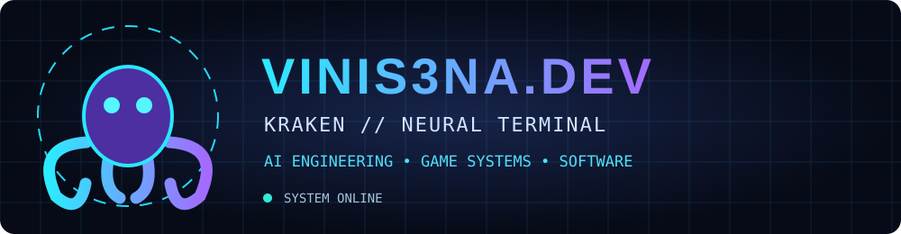
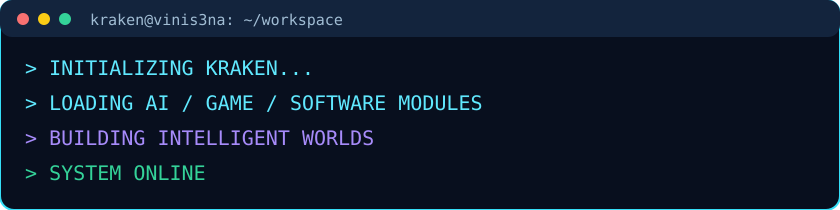
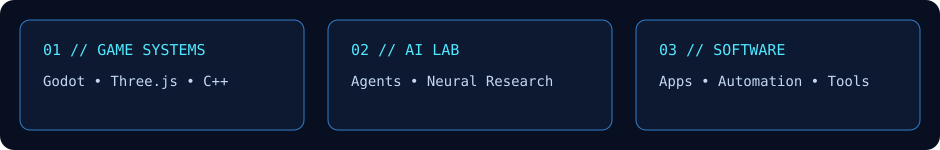

**KRAKEN // NEURAL TERMINAL** · IA · Jogos · Software

 

---

## 🐙 KRAKEN // Neural Terminal

---

## 🚀 Repositórios em Destaque

### 🎮 Jogos e Simuladores 3D

| Repositório | Descrição | Tecnologia |
|---|---|---|
| [N3xuscom](https://github.com/vinis3na-dev/N3xuscom) | Nexus Office — escritório 3D com servidor Python, painel web, voz e tela compartilhada | Godot 4.7 + Python |
| [AsteriaFrontier](https://github.com/vinis3na-dev/AsteriaFrontier) | Exploração espacial procedural — pousar, minerar, craftar, salvar | Godot 4.7 + GDScript |
| [ocean-survival-3d](https://github.com/vinis3na-dev/ocean-survival-3d) | Sobrevivência no mar — crafting, clima dinâmico, tubarões, ilhas | Godot 4.7 |
| [AFTERFALL](https://github.com/vinis3na-dev/AFTERFALL) | Jogo de sobrevivência — Alpha RC1 com código fonte recuperado | Godot 4.7 |
| [cw-cyberpunk-neon-alley](https://github.com/vinis3na-dev/cw-cyberpunk-neon-alley) | Mapa GTA V/FiveM vanilla — tema cyberpunk, CodeWalker | Lua + CodeWalker |
| [rocky](https://github.com/vinis3na-dev/rocky) | FPS em primeira pessoa — C++20 + Vulkan, câmera FPS, Mark 23 | C++ + Vulkan |
| [star](https://github.com/vinis3na-dev/star) | Jogo 3D de sobrevivência — ECS, Jolt Physics, OpenGL 4.6 PBR | C++20 |
| [skyhawk](https://github.com/vinis3na-dev/skyhawk) | Simulador de voo — Three.js + TypeScript + Vite | Three.js + TS |
| [piratas](https://github.com/vinis3na-dev/piratas) | Jogo 3D de piratas — mundo aberto, dia/noite, comércio | Three.js + JS |

### 🤖 IA e Automação

| Repositório | Descrição | Tecnologia |
|---|---|---|
| [control-center](https://github.com/vinis3na-dev/control-center) | Painel local para modelos Ollama/Colibri/OpenAI integrado ao OpenCode | Python |
| [sync-hub](https://github.com/vinis3na-dev/sync-hub) | Control room de agentes IA — fila, orçamento, escritório 3D | React + Express + Three.js |
| [kraken](https://github.com/vinis3na-dev/kraken) | Laboratório genômico — 21 espécies, mecanismos candidatos, benchmark | Python |
| [automathon](https://github.com/vinis3na-dev/automathon) | Automação de publicação YouTube — FastAPI + React + CustomTkinter | Python + React |
| [youtube-automation](https://github.com/vinis3na-dev/youtube-automation) | Programa desktop único para automação de publicação YouTube | Python |
| [tribuna-capixaba-app](https://github.com/vinis3na-dev/tribuna-capixaba-app) | Painel de curadoria de notícias RSS com IA — WordPress + redes sociais | Python |

### 🌐 Web

| Repositório | Descrição | Tecnologia |
|---|---|---|
| [last-delivery](https://github.com/vinis3na-dev/last-delivery) | Jogo pós-apocalíptico — sobrevivência/entrega, HTML5 Canvas puro | HTML5 + JS |

---

## 🛠️ Tecnologias Principais

---

## 📊 Atividade no GitHub

Os projetos e suas atividades podem ser consultados diretamente nos repositórios e no [histórico de contribuições](https://github.com/vinis3na-dev). Não são exibidos contadores fixos para evitar informações desatualizadas.

---

## 🤝 Vamos Conectar

---

**Feito com 🐙 e muito café por vinis3na-dev**

